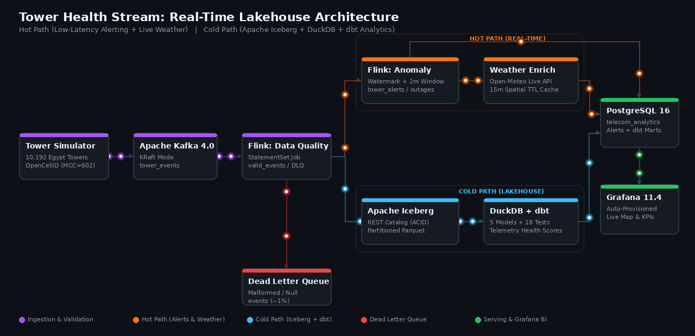
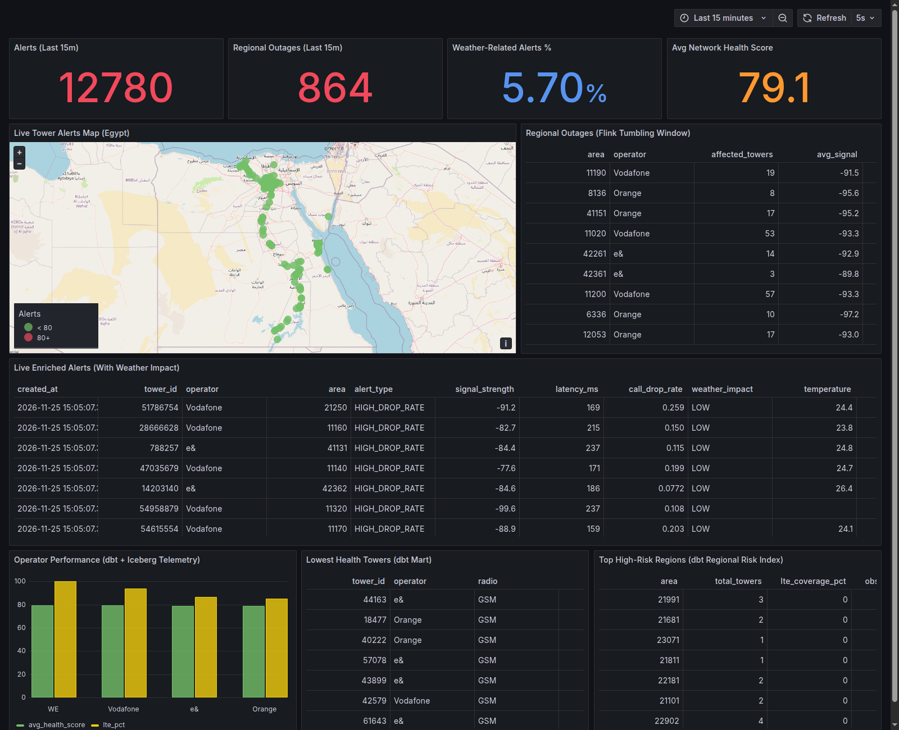
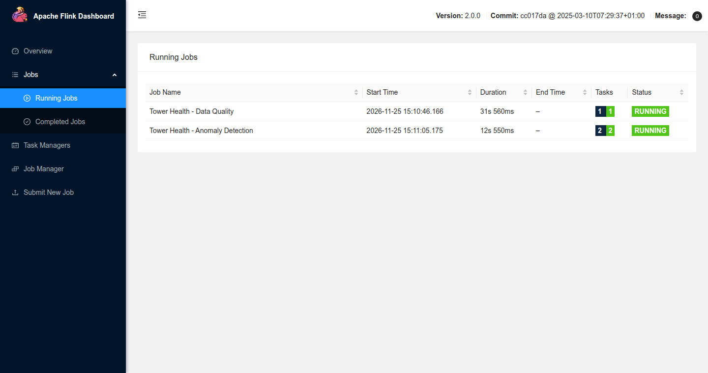
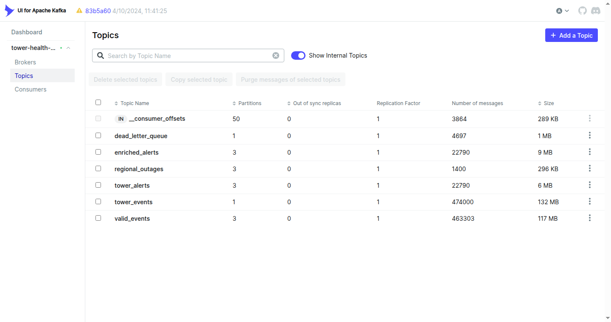

# Tower Health Stream

[](https://kafka.apache.org/)
[](https://flink.apache.org/)
[](https://iceberg.apache.org/)
[](https://www.getdbt.com/)
[](https://www.postgresql.org/)
[](https://grafana.com/)
[](https://docker.com/)
[](LICENSE)

**Real-Time Telecom Network Intelligence & Lakehouse Pipeline**

An end-to-end streaming and analytical data pipeline that monitors **10,192 real Egyptian cell towers** (OpenCelliD, `MCC=602`), validates live telemetry, detects tower-level anomalies and regional outages in real time with Apache Flink, correlates failures with live weather data, archives validated events in Apache Iceberg, and computes telemetry-driven health scores with dbt + DuckDB, all visualized on an auto-provisioned Grafana dashboard.

---

## Architecture (Hot Path + Cold Lakehouse Path)



```
OpenCelliD Dataset (10,192 Egyptian towers)
                 │
                 ▼
         Tower Simulator ──────► Kafka: tower_events
                                          │
                              Flink Job 1: Data Quality (StatementSet)
                              ┌───────────┴───────────┐
                              ▼                       ▼
                    Kafka: valid_events      Kafka: dead_letter_queue
                    ┌─────────┴───────────────────────┐
                    │ (Hot Path)                      │ (Cold / Lakehouse Path)
                    ▼                                 ▼
     Flink Job 2: Anomaly Detection             Iceberg Sink
          (StatementSet + Watermark)     (Partitioned by event_date, operator)
          ┌─────────┴─────────┐                       │
          ▼                   ▼                       ▼
 Kafka: tower_alerts   Kafka: regional_outages  Apache Iceberg
          │                   │                (telecom.valid_events)
          ▼                   │                       │
  Weather Enrichment          │                       ▼
 (Open-Meteo + TTL Cache)     │            Analytics Runner (DuckDB + dbt)
          │                   │          (stg_* -> marts + 18 dbt data tests)
          ▼                   │                       │
 Kafka: enriched_alerts       │                       │ (Atomic table swap)
          └─────────┬─────────┘                       │
                    ▼                                 ▼
              PostgreSQL Serving Layer (telecom_analytics)
                    │
                    ▼
       Grafana Dashboard (Auto-provisioned @ localhost:3000)
```

### Why This Stack? (Key Architectural Decisions)

| Layer | Technology | Why it's here |
|---|---|---|
| **Message Broker** | Apache Kafka 4.0 (KRaft) | Decouples producers from consumers, buffers spikes, enables multi-consumer fan-out (Flink + Iceberg) without ZooKeeper overhead. |
| **Stream Processing** | Apache Flink 2.0 (PyFlink SQL) | Stateful event-time processing with watermarks, tumbling windows (`REGIONAL_OUTAGE` for 3+ degraded towers), `EXACTLY_ONCE` checkpointing every 30s, and `StatementSet` single-read fan-out. |
| **Weather Enrichment** | Python Service + Spatial TTL Cache | Calls Open-Meteo per rounded `(lat, lon)` grid cell with a 15-minute TTL cache, cutting external API calls by >90% and avoiding rate limits / consumer lag. |
| **Lakehouse Storage** | Apache Iceberg (REST Catalog) | ACID open table format for full historical `valid_events`, partitioned by `(event_date, operator)` with batched 5,000-row / 30s flushes to prevent the small-files problem. |
| **Batch Analytics** | DuckDB + dbt-core | Reads the latest Iceberg snapshot via PyIceberg, builds staging + mart models (`tower_health_scores`, `operator_performance`, `regional_risk_index`) from **real telemetry**, validates 18 dbt data tests, atomically swaps tables in PostgreSQL, and prunes hot alerts older than 7 days. |
| **Serving & BI** | PostgreSQL 16 + Grafana 11.4 | Low-latency operational serving layer (7-day rolling retention for live alerts + dbt marts). Grafana datasource and 10-panel NOC dashboard (4 KPI stat cards + map + tables + charts) are auto-provisioned via code. |

> **Why no Airflow?** This pipeline is streaming-first; the batch layer is a single scheduled `analytics_runner.py` job (`Iceberg -> DuckDB -> dbt -> Postgres`). Running a full Airflow deployment for one task would add unnecessary operational overhead. If batch dependencies grow in production, the runner script can be triggered directly as an Airflow task with zero code changes.

---

## Kafka Topics

| Topic | Partitions | Producer | Consumer(s) | Purpose |
|---|---:|---|---|---|
| `tower_events` | 3 | Tower Simulator | Flink Data Quality | Raw telemetry keyed by `tower_id` |
| `valid_events` | 3 | Flink Data Quality | Flink Anomaly Detection, Iceberg Sink | Quality-validated telemetry |
| `dead_letter_queue` | 1 | Flink Data Quality | Monitoring / Auditing | Null or out-of-range telemetry |
| `tower_alerts` | 3 | Flink Anomaly Detection | Weather Enrichment | Single-tower anomaly alerts |
| `regional_outages` | 3 | Flink Anomaly Detection | PostgreSQL Sink | Windowed area-level outages (3+ towers) |
| `enriched_alerts` | 3 | Weather Enrichment | PostgreSQL Sink | Tower alerts enriched with live weather |

---

## Quick Start (One Command)

### Prerequisites
- Docker & Docker Compose
- Cleaned Egypt tower dataset at `data/towers_clean.csv` (if starting from raw OpenCelliD `MCC=602` CSV, save it to `data/towers_raw.csv` and run `python3 simulator/data_cleaner.py`).

### Start the Entire Stack

```bash
git clone https://github.com/AhmdGameel/tower-health-stream.git
cd tower-health-stream
cp .env.example .env
make up
```

`make up` automatically:
1. Starts Kafka (KRaft), creates all 6 topics, and starts Kafka UI.
2. Builds and starts Flink JobManager + TaskManager and submits both PyFlink jobs automatically.
3. Starts the Iceberg REST Catalog, PostgreSQL 16, and auto-provisioned Grafana.
4. Starts the Simulator, Weather Enrichment service, PostgreSQL Serving Sink, Iceberg Sink, and periodic dbt Analytics Runner.

### Useful Commands

```bash
make ps        # Check container status
make logs      # Follow logs across all services
make dbt-run   # Trigger an immediate Iceberg -> DuckDB -> dbt -> Postgres refresh
make down      # Stop all containers (keeps volumes)
make clean     # Stop containers and remove all volumes
```

### Service Endpoints

| Service | URL | Credentials |
|---|---|---|
| **Grafana Dashboard** | http://localhost:3000 | `admin` / `admin` |
| **Flink Dashboard** | http://localhost:8081 | None |
| **Kafka UI** | http://localhost:8080 | None |
| **Iceberg REST Catalog** | http://localhost:8182 | None |
| **PostgreSQL** | `localhost:5434` (`telecom_analytics`) | `telecom` / `telecom` |

---

## Live Screenshots

### Grafana Real-Time Dashboard (Auto-Provisioned)
Live Egypt OpenStreetMap alerts, Flink tumbling-window regional outages, Open-Meteo weather-enriched alerts, and dbt + Iceberg analytics marts:



### Apache Flink 2.0 - Running StatementSet Jobs
Single-source fan-out jobs for Data Quality and Event-Time Windowed Anomaly Detection:



### Apache Kafka 4.0 (KRaft) - Active Topics
Clean topic separation including Dead Letter Queue, Tower Alerts, Regional Outages, and Weather-Enriched Alerts:



---

## dbt Models & Data Quality Tests

All models live under [dbt_project/models/](dbt_project/models/) and are validated with **18 automated dbt tests** (`not_null`, `unique`, `accepted_values`) on every run:

- **Staging (Views):**
  - `stg_towers`: Deduplicated Egyptian tower inventory (`tower_id`, `operator`, `radio`, `lat`, `lon`, `area`).
  - `stg_telemetry`: Validated telemetry loaded from the latest Iceberg snapshot (`telecom.valid_events`).
- **Marts (Tables, exported atomically to PostgreSQL):**
  - `tower_health_scores`: Composite 0-100 health score per tower weighted by real signal strength (40%), call drop rate (30%), latency (20%), and radio technology (10%).
  - `operator_performance`: Operator KPIs (`Vodafone`, `e&`, `Orange`, `WE`) ranked by average composite health score.
  - `regional_risk_index`: Area-level risk score (`LOW`, `MEDIUM`, `HIGH`) combining legacy infrastructure ratio and observed telemetry health.

---

## Project Structure

```
tower-health-stream/
├── Makefile
├── requirements.txt
├── .env.example
├── simulator/
│   ├── data_cleaner.py          # Cleans raw OpenCelliD CSV -> data/towers_clean.csv
│   └── tower_simulator.py       # Emits keyed tower telemetry (+ ~1% bad records for DLQ)
├── flink_jobs/
│   ├── data_quality.py          # Single StatementSet job: valid_events + dead_letter_queue
│   └── anomaly_detection.py     # Single StatementSet job: tower_alerts + regional_outages
├── services/
│   ├── weather_enrichment.py    # Open-Meteo enrichment with spatial TTL cache
│   ├── postgres_sink.py         # Batched serving sink for enriched_alerts & regional_outages
│   ├── iceberg_sink.py          # Partitioned, batched writer to Iceberg REST Catalog
│   └── analytics_runner.py      # Iceberg -> DuckDB -> dbt run/test -> PostgreSQL atomic swap
├── dbt_project/
│   ├── dbt_project.yml
│   ├── profiles.yml
│   └── models/
│       ├── staging/             # stg_towers, stg_telemetry, schema.yml
│       └── marts/               # tower_health_scores, operator_performance, regional_risk_index, schema.yml
├── docker/
│   ├── docker-compose.yml       # Full containerized stack
│   ├── Dockerfile.flink         # Flink 2.0 + Kafka SQL connector JAR downloaded at build time
│   ├── Dockerfile.python        # Shared Python 3.12 image for streaming & analytics services
│   └── grafana/provisioning/    # Auto-provisioned PostgreSQL datasource + 6-panel dashboard JSON
└── docs/
    └── architecture.md
```

---

## License

MIT with Attribution. See [LICENSE](LICENSE) for full terms.
